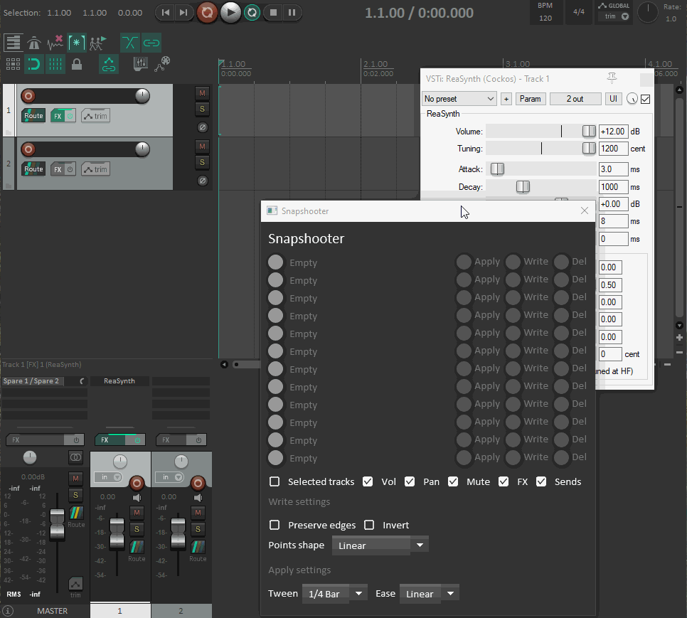
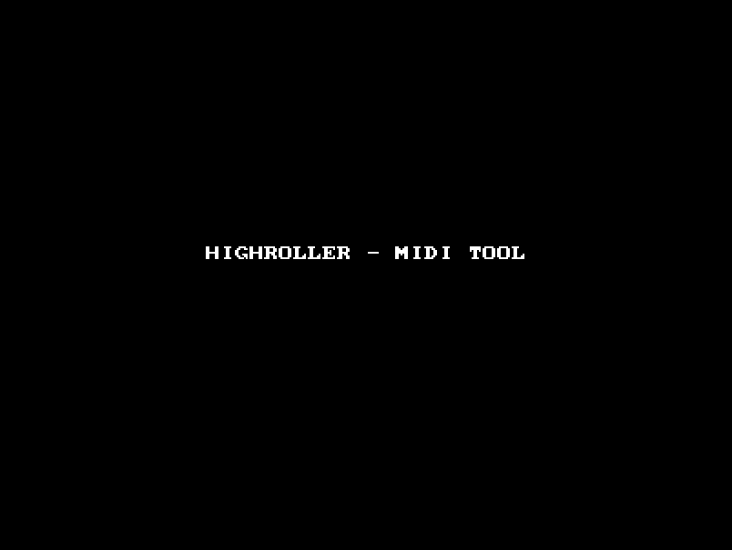
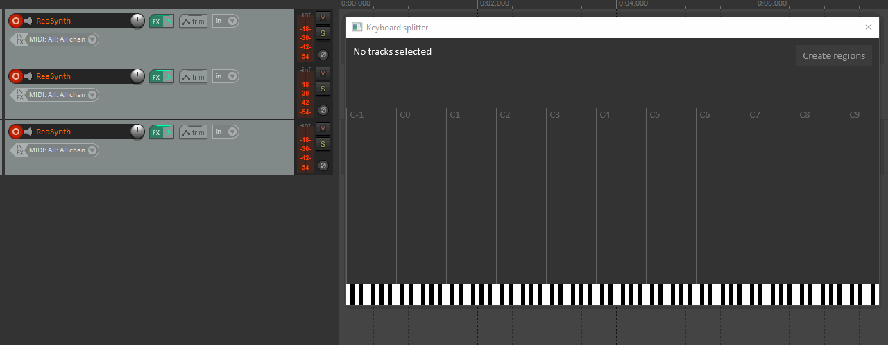
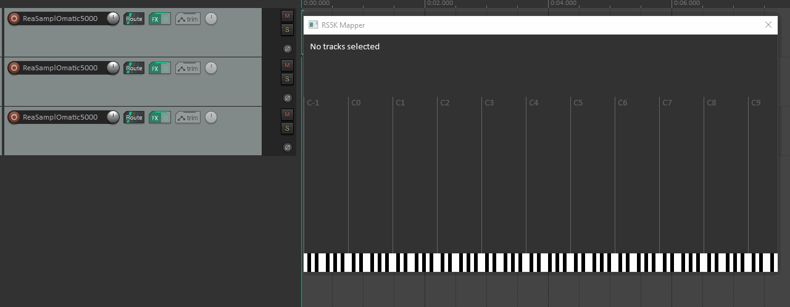

The following effects are published and available on ReaPack

## Snapshooter

Snapshooter allows to create param snapshots and recall or write them to the playlist creating patch morphs.
Different from SWS snapshots, only the params changed are written to the playlist as automation points.

#### Features:
  * Stores and retrieves FX params
  * Stores and retrieves mixer states for track Volume, Pan, Mute and Sends
  * Writes only changed params by diffing the current state and selected snapshot
  * Transition snapshots using tween and ease functions
  * Writes transitions into time selection from current state to snapshot

#### Tips:
  * Grab time selections and click write to write transitions into timeline
  * Set global automation to READ to write snapshot from current state
  * Use global automation BYPASS to write transitions when automation already exists on the playlist
  * Snapshots can be written directly into cursor when there is no time selection
  * If params are not writing make sure they have a different current value from the snapshot

## HighRoller - MIDI Toolkit

A set of tools to manipulate midi notes.
Useful to create snare or hat rolls for risers or trap beats or manipulate midi in general.

Comes with scripts to execute the MIDI tools using shortcuts, also works in the inline MIDI editor.

Requires ReaImGui installed.

#### Tools:

* Flip Horizontal - flips selected notes horizontally
* Flip Vertical - flips selected notes vertically
* Rotate Left - Rotates selected notes left by grid division
* Rotate Right - Rotates selected notes right by grid division
* Split - Adds a subdivision to notes and spaces splits equally
* Glue - Removes a subdivision from consecutive notes
* Split x2 - Adds two subdivisions to each note
* Glue :2 - Removes two subdivisions from consecutive notes
* Gate - Increase or decrease notes length proportionally to their original length
* Gate Ramp - Progressively increment or decrement notes length
* Warp - Bend notes start time towards the first or last note
* Vel Ramp - Progressively increment or decrement notes velocity

## Keyboard splitter

Manage tracks keyboard splitting using a visual keymap.

## RS5K Mapper

Allows mapping multiple ReaSamplomatic5000 instances using a visual keymap.

